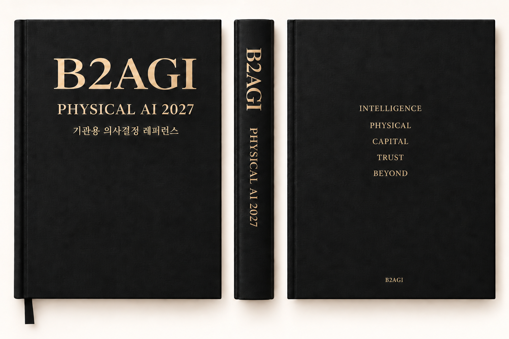

# B2AGI Physical AI White Paper 2027

<!-- B2AGI EPAI INTRO -->
**B2AGI | EPAI**  
Embodied Physical Agentic Intelligence

EPAI is an integrated intelligence framework proposed by B2AGI, connecting Embodied AI, Physical AI, and Agentic AI across technology, industry, capital, and governance.

Explore B2AGI’s research, field notes, industry analysis, and multilingual publications.

#B2AGI #EPAI #EmbodiedPhysicalAgenticIntelligence #EmbodiedAI #PhysicalAI #AIAgent #AgenticAI
<!-- /B2AGI EPAI INTRO -->

Illustrated chapter guide · Five parts · 46 chapters

**Industry, Capital, Security & Global Cooperation**

[English](README.md) · [한국어](i18n/ko/README.md) · [简体中文](i18n/zh-CN/README.md) · [Español](i18n/es/README.md) · [Français](i18n/fr/README.md) · [العربية](i18n/ar/README.md)

What separates a successful demonstration from work a customer can rely on?

Five parts and 46 chapters follow Physical AI from models and machines to customer operations, financing, security and coexistence. Read by chapter, or start with the question closest to your work.

[B2AGI](https://b2agi.com/) · [Atlas](https://github.com/b2agi/physical-ai-ranking-2027) · [Instagram](https://www.instagram.com/b2agi/)

## Contents

### 1. Intelligence

- [01 — Physical AI in 2027](chapters/01-physical-ai-in-2027.md)
- [02 — Choosing the Right Body](chapters/02-choosing-the-right-body.md)
- [03 — From Models to Action](chapters/03-from-models-to-action.md)
- [04 — The Robot Learning Industry](chapters/04-the-robot-learning-industry.md)
- [05 — Physical AI Value Chain](chapters/05-physical-ai-value-chain.md)
- [06 — From Demonstration to Deployment](chapters/06-from-demonstration-to-deployment.md)

### 2. Physical

- [07 — Who Needs Physical AI?](chapters/07-who-needs-physical-ai.md)
- [08 — Reading the Field](chapters/08-reading-the-field.md)
- [09 — China: Building an Industry](chapters/09-china-building-an-industry.md)
- [10 — China’s Industrial Clusters](chapters/10-china-s-industrial-clusters.md)
- [11 — China: Companies and Customers](chapters/11-china-companies-and-customers.md)
- [12 — America: Models, Capital, and Customers](chapters/12-america-models-capital-and-customers.md)
- [13 — America’s Industrial Clusters](chapters/13-america-s-industrial-clusters.md)
- [14 — Korea: From Manufacturing Strength to New Markets](chapters/14-korea-from-manufacturing-strength-to-new-markets.md)
- [15 — Korea’s Industrial Clusters](chapters/15-korea-s-industrial-clusters.md)
- [16 — Manufacturing and Logistics: Where Automation Pays](chapters/16-manufacturing-and-logistics-where-automation-pays.md)
- [17 — Intelligence in Motion](chapters/17-intelligence-in-motion.md)
- [18 — Physical AI in Everyday Life](chapters/18-physical-ai-in-everyday-life.md)
- [19 — Comparing China, America, and Korea](chapters/19-comparing-china-america-and-korea.md)
- [20 — From Global Examples to Local Deployment](chapters/20-from-global-examples-to-local-deployment.md)

### 3. Capital

- [21 — Public Funding: From Policy to Practice](chapters/21-public-funding-from-policy-to-practice.md)
- [22 — Who Finances Physical AI?](chapters/22-who-finances-physical-ai.md)
- [23 — Why Customers Buy Again](chapters/23-why-customers-buy-again.md)
- [24 — The True Cost of a Task](chapters/24-the-true-cost-of-a-task.md)
- [25 — Revenue, Margins, and Value Capture](chapters/25-revenue-margins-and-value-capture.md)
- [26 — Reading the Financial Statements](chapters/26-reading-the-financial-statements.md)
- [27 — Financing Robot Assets](chapters/27-financing-robot-assets.md)
- [28 — Robot Assets, RWA, STO, and Tokenization](chapters/28-robot-assets-rwa-sto-and-tokenization.md)
- [29 — The Agent Transaction Economy](chapters/29-the-agent-transaction-economy.md)
- [30 — What Makes an Investment Work?](chapters/30-what-makes-an-investment-work.md)

### 4. Trust

- [31 — Safety and Accountability](chapters/31-safety-and-accountability.md)
- [32 — Securing Physical AI](chapters/32-securing-physical-ai.md)
- [33 — Industrial Sovereignty, National Security, and Cooperation](chapters/33-industrial-sovereignty-national-security-and-cooperation.md)
- [34 — Identity, Delegation, and Authority](chapters/34-identity-delegation-and-authority.md)
- [35 — The Regulatory Landscape](chapters/35-the-regulatory-landscape.md)
- [36 — Standards, Certification, and Assurance](chapters/36-standards-certification-and-assurance.md)
- [37 — TRACE: Records of Action and Change](chapters/37-trace-records-of-action-and-change.md)
- [38 — A Common Language for Work and Evidence](chapters/38-a-common-language-for-work-and-evidence.md)
- [39 — From Evidence to Decisions](chapters/39-from-evidence-to-decisions.md)

### 5. Beyond

- [40 — Work, Skills, and the Automation Transition](chapters/40-work-skills-and-the-automation-transition.md)
- [41 — Environmental Impact and Public Value](chapters/41-environmental-impact-and-public-value.md)
- [42 — New Bodies, Continuing Intelligence](chapters/42-new-bodies-continuing-intelligence.md)
- [43 — Operating Through Disconnection](chapters/43-operating-through-disconnection.md)
- [44 — The Moon and Mars: What Exploration Demands](chapters/44-the-moon-and-mars-what-exploration-demands.md)
- [45 — Coexistence with Non-Human Intelligences](chapters/45-coexistence-with-non-human-intelligences.md)
- [46 — 2028: Revisiting Our Judgments](chapters/46-2028-revisiting-our-judgments.md)

## Explore the Atlas

- [Countries 20](https://github.com/b2agi/physical-ai-ranking-2027/blob/main/COUNTRIES.md)
- [Clusters 20](https://github.com/b2agi/physical-ai-ranking-2027/blob/main/CLUSTERS.md)
- [Current 100](https://github.com/b2agi/physical-ai-ranking-2027/blob/main/CURRENT_100.md)
- [Next 100](https://github.com/b2agi/physical-ai-ranking-2027/blob/main/NEXT_100.md)
- [Influence 50](https://github.com/b2agi/physical-ai-ranking-2027/blob/main/INFLUENCE_50.md)
- [Ecosystem Builders 50](https://github.com/b2agi/physical-ai-ranking-2027/blob/main/ECOSYSTEM_BUILDERS_50.md)
- [Institutions 50](https://github.com/b2agi/physical-ai-ranking-2027/blob/main/INSTITUTIONS_50.md)

## Cite this edition

This illustrated reading guide brings together the chapter artwork and published summaries. It is not the full white paper text. The artwork retains its original Korean and English lettering.

B2AGI. *Physical AI White Paper 2027: Illustrated Chapter Guide*. 2027 edition; reading-guide release: 14 October 2026.

[Edition & sources](EDITION.md) · [Rights](RIGHTS.md) · [Chapter data](data/chapters.json)
