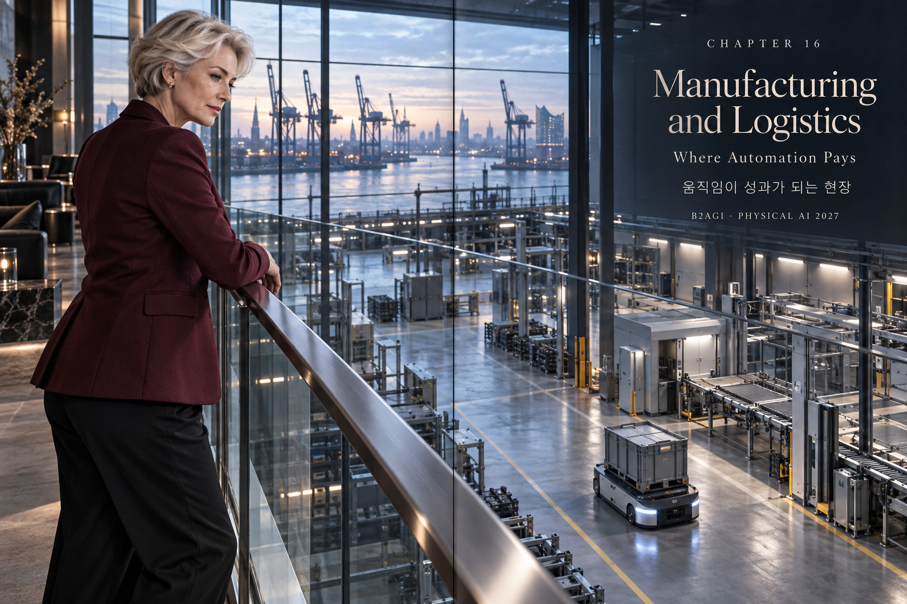
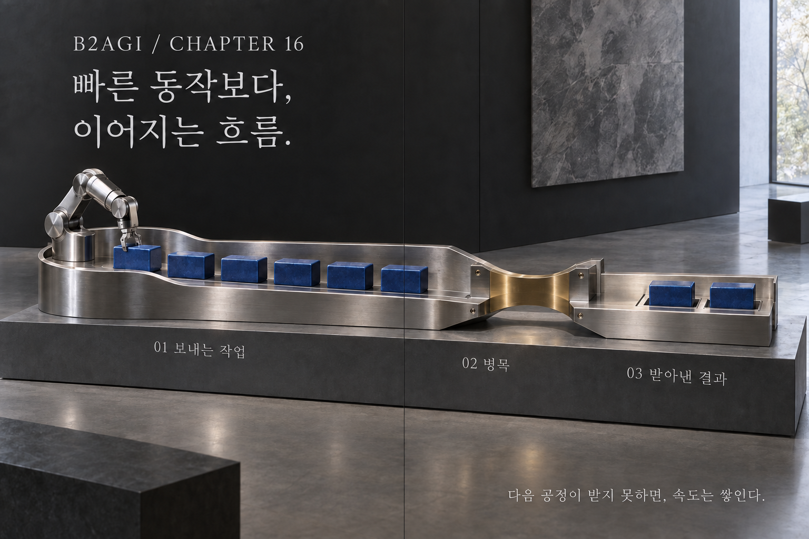

# 16 — Manufacturing and Logistics: Where Automation Pays

B2AGI Physical AI White Paper 2027 · Physical

[English](16-manufacturing-and-logistics-where-automation-pays.md) · [한국어](../i18n/ko/chapters/16-manufacturing-and-logistics-where-automation-pays.md) · [简体中文](../i18n/zh-CN/chapters/16-manufacturing-and-logistics-where-automation-pays.md) · [Español](../i18n/es/chapters/16-manufacturing-and-logistics-where-automation-pays.md) · [Français](../i18n/fr/chapters/16-manufacturing-and-logistics-where-automation-pays.md) · [العربية](../i18n/ar/chapters/16-manufacturing-and-logistics-where-automation-pays.md)

## Chapter guide

The customer buys a completed workflow. In factories and warehouses, automation creates value when handling, inspection, transport, and the next process work together.

[Previous](15-korea-s-industrial-clusters.md) · [Contents](../README.md) · [Next](17-intelligence-in-motion.md)

[B2AGI](https://b2agi.com/) · [Atlas](https://github.com/b2agi/physical-ai-ranking-2027) · [Edition & sources](../EDITION.md)
