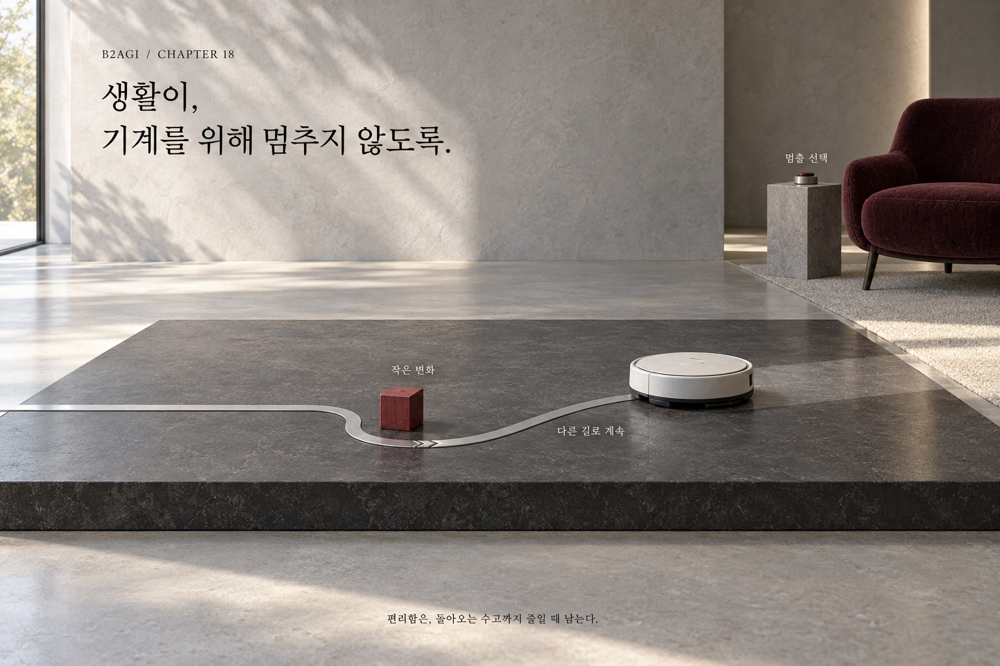

# 18 — Physical AI in Everyday Life

B2AGI Physical AI White Paper 2027 · Physical

[English](18-physical-ai-in-everyday-life.md) · [한국어](../i18n/ko/chapters/18-physical-ai-in-everyday-life.md) · [简体中文](../i18n/zh-CN/chapters/18-physical-ai-in-everyday-life.md) · [Español](../i18n/es/chapters/18-physical-ai-in-everyday-life.md) · [Français](../i18n/fr/chapters/18-physical-ai-in-everyday-life.md)

## Chapter guide

Everyday environments bring changing spaces, users, and expectations. Useful systems must fit those conditions while preserving safety, accessibility, and people’s ability to choose how they receive assistance.

[Previous](17-intelligence-in-motion.md) · [Contents](../README.md) · [Next](19-comparing-china-america-and-korea.md)

[B2AGI](https://b2agi.com/) · [Atlas](https://github.com/b2agi/physical-ai-ranking-2027) · [Edition & sources](../EDITION.md)
