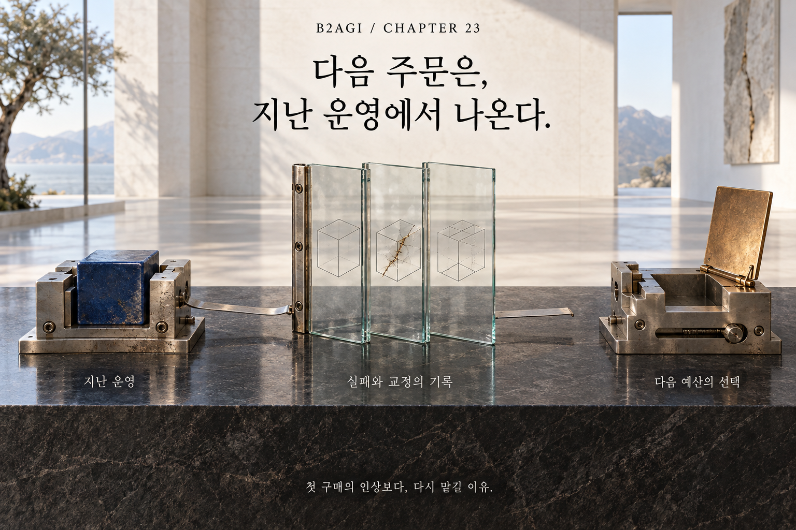

# 23 — Why Customers Buy Again

B2AGI Physical AI White Paper 2027 · Capital

[English](23-why-customers-buy-again.md) · [한국어](../i18n/ko/chapters/23-why-customers-buy-again.md) · [简体中文](../i18n/zh-CN/chapters/23-why-customers-buy-again.md) · [Español](../i18n/es/chapters/23-why-customers-buy-again.md) · [Français](../i18n/fr/chapters/23-why-customers-buy-again.md) · [العربية](../i18n/ar/chapters/23-why-customers-buy-again.md)

## Chapter guide

Repeat purchases reveal what customers found worth keeping. They depend on operating results, service quality, and a value proposition that survives beyond the first installation.

[Previous](22-who-finances-physical-ai.md) · [Contents](../README.md) · [Next](24-the-true-cost-of-a-task.md)

[B2AGI](https://b2agi.com/) · [Atlas](https://github.com/b2agi/physical-ai-ranking-2027) · [Edition & sources](../EDITION.md)
