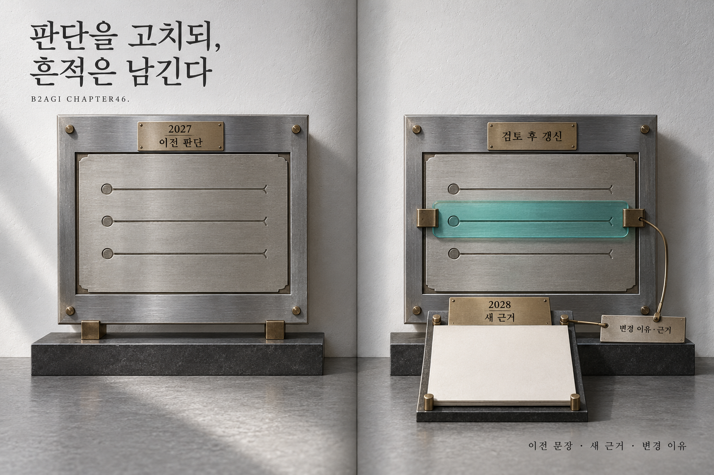

# 46 — 2028: Revisiting Our Judgments

B2AGI Physical AI White Paper 2027 · Beyond

[English](46-2028-revisiting-our-judgments.md) · [한국어](../i18n/ko/chapters/46-2028-revisiting-our-judgments.md) · [简体中文](../i18n/zh-CN/chapters/46-2028-revisiting-our-judgments.md) · [Español](../i18n/es/chapters/46-2028-revisiting-our-judgments.md) · [Français](../i18n/fr/chapters/46-2028-revisiting-our-judgments.md) · [العربية](../i18n/ar/chapters/46-2028-revisiting-our-judgments.md)

## Chapter guide

An almanac becomes more useful when its judgments can be revisited. The next edition will compare earlier assessments with new evidence, preserving both the changes and the reasons behind them.

[Previous](45-coexistence-with-non-human-intelligences.md) · [Contents](../README.md)

[B2AGI](https://b2agi.com/) · [Atlas](https://github.com/b2agi/physical-ai-ranking-2027) · [Edition & sources](../EDITION.md)
