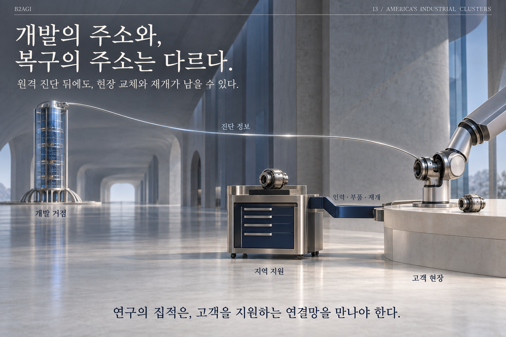

# 13. التجمعات الصناعية في الولايات المتحدة

الكتاب الأبيض للذكاء الاصطناعي المادي 2027 · B2AGI

[English](../../../chapters/13-america-s-industrial-clusters.md) · [한국어](../../ko/chapters/13-america-s-industrial-clusters.md) · [简体中文](../../zh-CN/chapters/13-america-s-industrial-clusters.md) · [Español](../../es/chapters/13-america-s-industrial-clusters.md) · [Français](../../fr/chapters/13-america-s-industrial-clusters.md) · [العربية](13-america-s-industrial-clusters.md)

غالباً ما تتوزع مراكز البحث والتصنيع والتمويل ودعم العملاء على أماكن مختلفة. وتوضح الروابط بينها كيف تطور الشركة منتجاً وتحافظ على عمله في الميدان.

[الفصل السابق](12-america-models-capital-and-customers.md) · [الفهرس](../README.md) · [الفصل التالي](14-korea-from-manufacturing-strength-to-new-markets.md)

[الموقع بالعربية](https://b2agi.com/ar/) · [الأطلس](https://github.com/b2agi/physical-ai-ranking-2027/tree/main/i18n/ar) · [الإصدار والمصادر · الإنجليزية](../../../EDITION.md)

