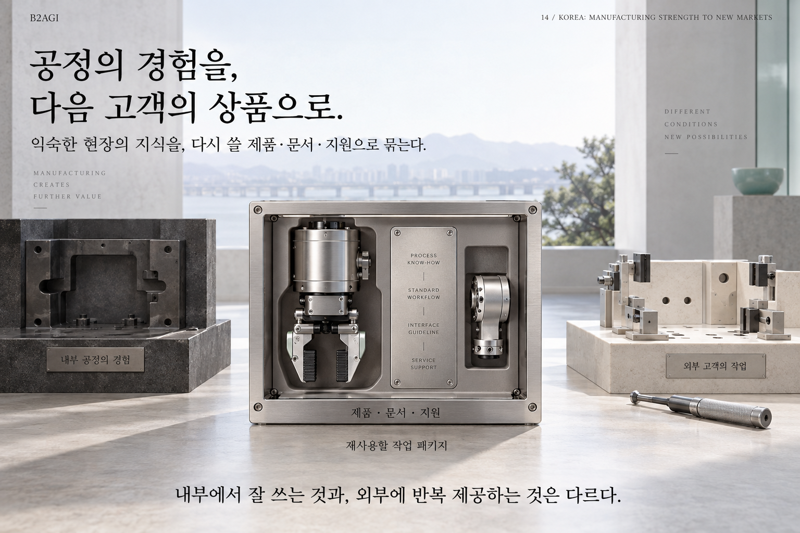

# 14. كوريا الجنوبية: من القوة التصنيعية إلى أسواق جديدة

الكتاب الأبيض للذكاء الاصطناعي المادي 2027 · B2AGI

[English](../../../chapters/14-korea-from-manufacturing-strength-to-new-markets.md) · [한국어](../../ko/chapters/14-korea-from-manufacturing-strength-to-new-markets.md) · [简体中文](../../zh-CN/chapters/14-korea-from-manufacturing-strength-to-new-markets.md) · [Español](../../es/chapters/14-korea-from-manufacturing-strength-to-new-markets.md) · [Français](../../fr/chapters/14-korea-from-manufacturing-strength-to-new-markets.md) · [العربية](14-korea-from-manufacturing-strength-to-new-markets.md)

تمنح الخبرة التصنيعية معرفة دقيقة بمهام الإنتاج. وتحويلها إلى منتجات لعملاء خارجيين يحتاج إلى أساليب تكامل قابلة لإعادة الاستخدام وتوثيق ودعم مناسبين.

[الفصل السابق](13-america-s-industrial-clusters.md) · [الفهرس](../README.md) · [الفصل التالي](15-korea-s-industrial-clusters.md)

[الموقع بالعربية](https://b2agi.com/ar/) · [الأطلس](https://github.com/b2agi/physical-ai-ranking-2027/tree/main/i18n/ar) · [الإصدار والمصادر · الإنجليزية](../../../EDITION.md)

