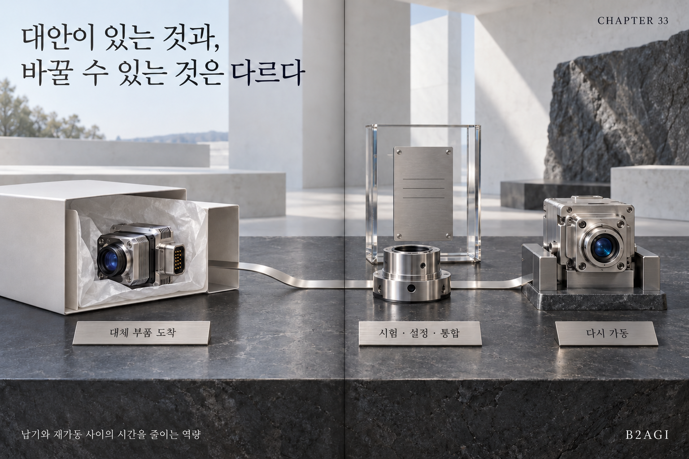

# 33. السيادة الصناعية والأمن الوطني والتعاون

الكتاب الأبيض للذكاء الاصطناعي المادي 2027 · B2AGI

[English](../../../chapters/33-industrial-sovereignty-national-security-and-cooperation.md) · [한국어](../../ko/chapters/33-industrial-sovereignty-national-security-and-cooperation.md) · [简体中文](../../zh-CN/chapters/33-industrial-sovereignty-national-security-and-cooperation.md) · [Español](../../es/chapters/33-industrial-sovereignty-national-security-and-cooperation.md) · [Français](../../fr/chapters/33-industrial-sovereignty-national-security-and-cooperation.md) · [العربية](33-industrial-sovereignty-national-security-and-cooperation.md)

تعتمد المرونة على الحفاظ على الوظائف الحيوية وتشغيل البدائل. وتسهم سلاسل التوريد وقدرات الاستبدال والتعاون الدولي في تحديد هذه القدرة.

[الفصل السابق](32-securing-physical-ai.md) · [الفهرس](../README.md) · [الفصل التالي](34-identity-delegation-and-authority.md)

[الموقع بالعربية](https://b2agi.com/ar/) · [الأطلس](https://github.com/b2agi/physical-ai-ranking-2027/tree/main/i18n/ar) · [الإصدار والمصادر · الإنجليزية](../../../EDITION.md)

