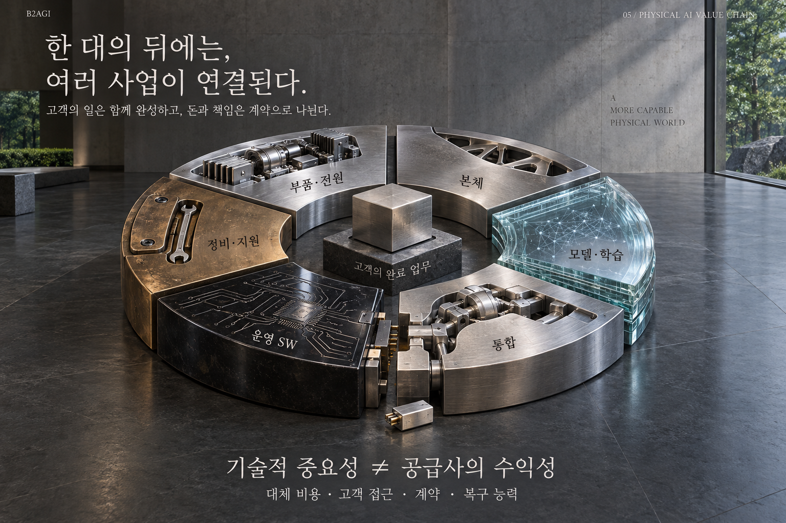

# 05 — La cadena de valor de la IA física

B2AGI Libro blanco de la IA física 2027 · Intelligence

[English](../../../chapters/05-physical-ai-value-chain.md) · [한국어](../../ko/chapters/05-physical-ai-value-chain.md) · [简体中文](../../zh-CN/chapters/05-physical-ai-value-chain.md) · [Español](05-physical-ai-value-chain.md) · [Français](../../fr/chapters/05-physical-ai-value-chain.md)

## Guía del capítulo

Detrás de un robot hay proveedores de componentes, desarrolladores de modelos, integradores y equipos de software y servicio. Sus aportaciones técnicas, sus ingresos y sus responsabilidades siguen caminos distintos.

[Anterior](04-the-robot-learning-industry.md) · [Índice](../README.md) · [Siguiente](06-from-demonstration-to-deployment.md)

[B2AGI](https://b2agi.com/) · [Atlas](https://github.com/b2agi/physical-ai-ranking-2027) · [Edition & sources](../../../EDITION.md)
