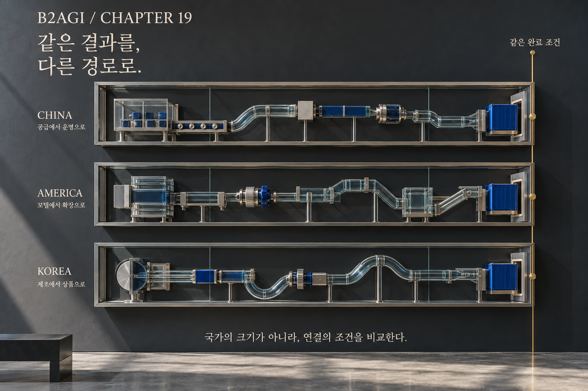

# 19 — Comparar China, Estados Unidos y Corea del Sur

B2AGI Libro blanco de la IA física 2027 · Physical

[English](../../../chapters/19-comparing-china-america-and-korea.md) · [한국어](../../ko/chapters/19-comparing-china-america-and-korea.md) · [简体中文](../../zh-CN/chapters/19-comparing-china-america-and-korea.md) · [Español](19-comparing-china-america-and-korea.md) · [Français](../../fr/chapters/19-comparing-china-america-and-korea.md) · [العربية](../../ar/chapters/19-comparing-china-america-and-korea.md)

## Guía del capítulo

Los países comparten cadenas de suministro y mercados. Una comparación útil plantea las mismas preguntas sobre tecnología, clientes, capital y operaciones, sin borrar las condiciones de cada mercado.

[Anterior](18-physical-ai-in-everyday-life.md) · [Índice](../README.md) · [Siguiente](20-from-global-examples-to-local-deployment.md)

[B2AGI](https://b2agi.com/) · [Atlas](https://github.com/b2agi/physical-ai-ranking-2027) · [Edición y fuentes](../../../EDITION.md)

<!-- B2AGI EPAI SIGNATURE -->
---

**B2AGI | EPAI**  
Embodied Physical Agentic Intelligence  
[Research & Publications](https://b2agi.com/) · [White Paper](https://github.com/b2agi/physical-ai-white-paper-2027) · [Industry Atlas](https://github.com/b2agi/physical-ai-ranking-2027)
<!-- /B2AGI EPAI SIGNATURE -->
