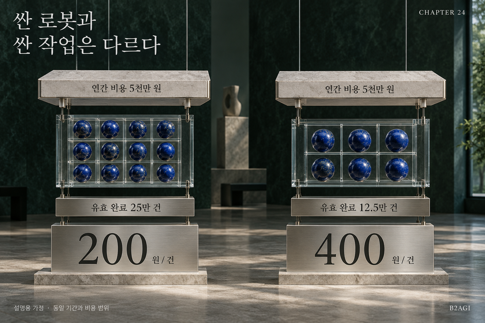

# 24 — El coste real de una tarea

B2AGI Libro blanco de la IA física 2027 · Capital

[English](../../../chapters/24-the-true-cost-of-a-task.md) · [한국어](../../ko/chapters/24-the-true-cost-of-a-task.md) · [简体中文](../../zh-CN/chapters/24-the-true-cost-of-a-task.md) · [Español](24-the-true-cost-of-a-task.md) · [Français](../../fr/chapters/24-the-true-cost-of-a-task.md)

## Guía del capítulo

El precio de compra es solo una parte. El coste por tarea aceptada también depende de la integración, la supervisión, el mantenimiento, las paradas y el volumen de trabajo útil realmente completado.

[Anterior](23-why-customers-buy-again.md) · [Índice](../README.md) · [Siguiente](25-revenue-margins-and-value-capture.md)

[B2AGI](https://b2agi.com/) · [Atlas](https://github.com/b2agi/physical-ai-ranking-2027) · [Edición y fuentes](../../../EDITION.md)
