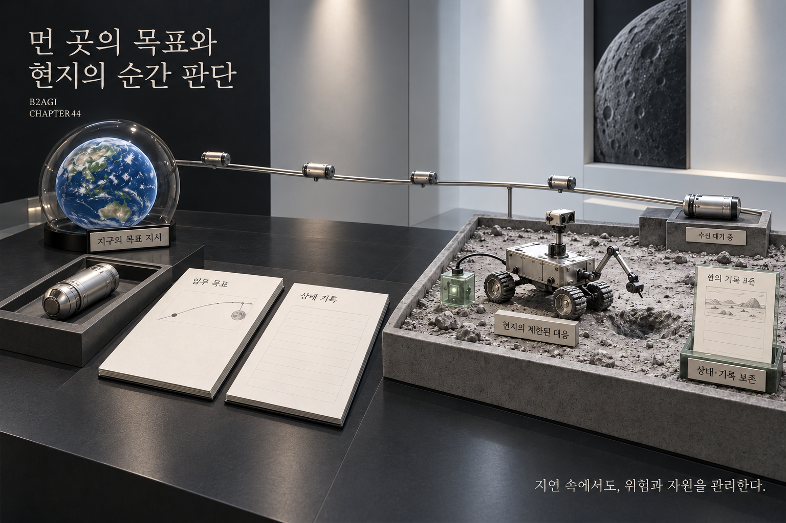

# 44 — La Lune et Mars : les exigences de l’exploration

B2AGI Livre blanc de l’IA physique 2027 · Beyond

[English](../../../chapters/44-the-moon-and-mars-what-exploration-demands.md) · [한국어](../../ko/chapters/44-the-moon-and-mars-what-exploration-demands.md) · [简体中文](../../zh-CN/chapters/44-the-moon-and-mars-what-exploration-demands.md) · [Español](../../es/chapters/44-the-moon-and-mars-what-exploration-demands.md) · [Français](44-the-moon-and-mars-what-exploration-demands.md) · [العربية](../../ar/chapters/44-the-moon-and-mars-what-exploration-demands.md)

## Guide du chapitre

Latence, énergie limitée et réparations difficiles entrent dans la planification quotidienne. Ces conditions révèlent les exigences concrètes de l’autonomie locale, de la reprise fiable et de la continuité des opérations.

[Précédent](43-operating-through-disconnection.md) · [Sommaire](../README.md) · [Suivant](45-coexistence-with-non-human-intelligences.md)

[B2AGI](https://b2agi.com/) · [Atlas](https://github.com/b2agi/physical-ai-ranking-2027) · [Édition et sources](../../../EDITION.md)

<!-- B2AGI EPAI SIGNATURE -->
---

**B2AGI | EPAI**  
Embodied Physical Agentic Intelligence  
[Research & Publications](https://b2agi.com/) · [White Paper](https://github.com/b2agi/physical-ai-white-paper-2027) · [Industry Atlas](https://github.com/b2agi/physical-ai-ranking-2027)
<!-- /B2AGI EPAI SIGNATURE -->
