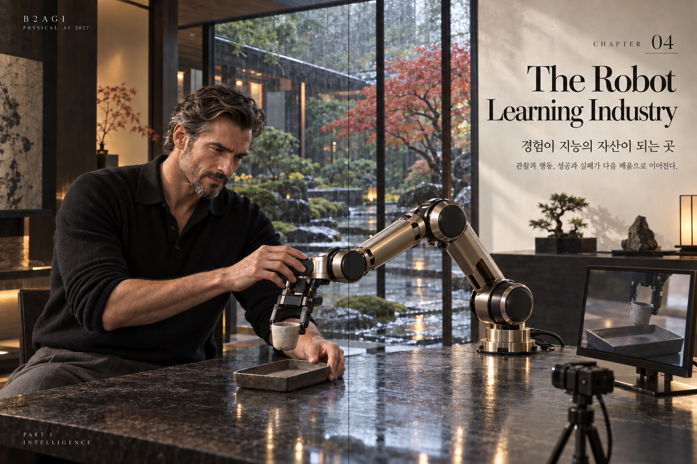
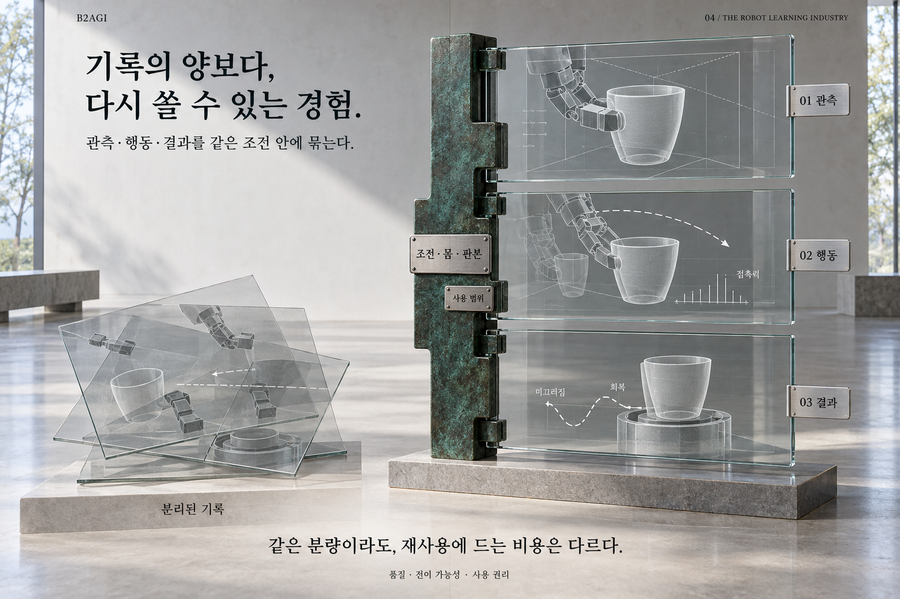

# 04 — 경험을 생산하고 거래하는 산업

B2AGI 피지컬 AI 백서 2027 · Intelligence

[English](../../../chapters/04-the-robot-learning-industry.md) · [한국어](04-the-robot-learning-industry.md) · [简体中文](../../zh-CN/chapters/04-the-robot-learning-industry.md) · [Español](../../es/chapters/04-the-robot-learning-industry.md) · [Français](../../fr/chapters/04-the-robot-learning-industry.md)

## 장별 해설

원격조작은 학습용 경험을 생산하기도 하고 운영 중 예외를 해결하기도 한다. 전자는 개발 투입이고 후자는 반복 서비스 비용이다. 운영 개입을 다음 학습에 활용하려면 품질 관리와 적용 판단의 경로가 필요하다. 수집 인력과 조건을 정리하는 인력은 서로 다른 일을 한다.

디지털 트윈은 어떤 결정을 돕는지로 평가한다. 외형과 동선을 검토하는 모형과 제어·센서 조건을 시험하는 모형은 필요한 정밀도가 다르다. 설치 전 배치 수정으로 개발·통합비를 줄인 효과와 실제 운영비 절감은 따로 확인한다.

[이전 장](03-from-models-to-action.md) · [목차](../README.md) · [다음 장](05-physical-ai-value-chain.md)

[B2AGI](https://b2agi.com/) · [Atlas](https://github.com/b2agi/physical-ai-ranking-2027) · [판본·자료 안내](../../../EDITION.md)
