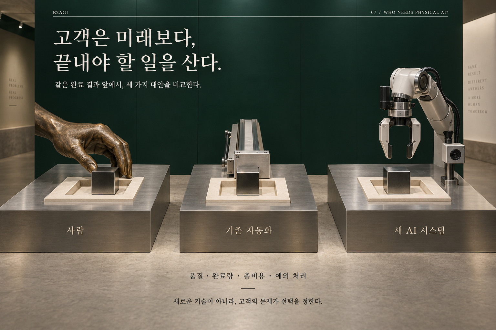

# 07 — 누가, 왜 피지컬 AI를 필요로 하는가?

B2AGI 피지컬 AI 백서 2027 · Physical

[English](../../../chapters/07-who-needs-physical-ai.md) · [한국어](07-who-needs-physical-ai.md) · [简体中文](../../zh-CN/chapters/07-who-needs-physical-ai.md) · [Español](../../es/chapters/07-who-needs-physical-ai.md) · [Français](../../fr/chapters/07-who-needs-physical-ai.md) · [العربية](../../ar/chapters/07-who-needs-physical-ai.md)

## 장별 해설

서비스는 사용자와 공간 변화 속에서 청소·운반·안내의 반복 결과를 유지해야 한다. 농업은 생물과 날씨, 짧은 수확기와 비수기 유지비가 조건이다. 돌봄의 직접 신체 보조와 물건 운반·안내 같은 간접 지원은 다른 안전·신뢰 부담을 갖는다.

정돈된 환경, 반복 가능한 작업, 관리 가능한 실패는 초기 도입에 유리할 수 있다. 같은 작업도 지역의 전력·통신·언어·정비와 접근성에 따라 조건이 달라진다. 한 나라의 보급 순서를 모든 지역에 옮기지 않는다.

[이전 장](06-from-demonstration-to-deployment.md) · [목차](../README.md) · [다음 장](08-reading-the-field.md)

[B2AGI](https://b2agi.com/) · [Atlas](https://github.com/b2agi/physical-ai-ranking-2027) · [판본·자료 안내](../../../EDITION.md)
