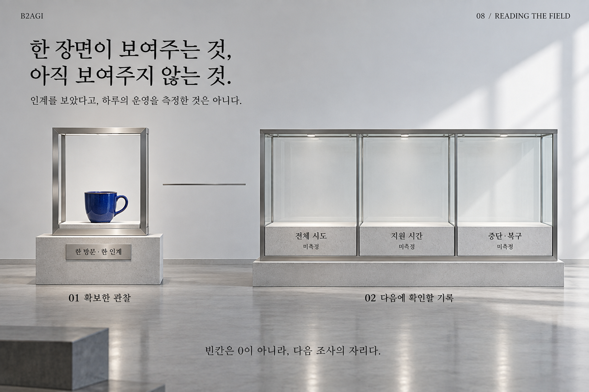

# 08 — 현장에서 산업을 읽는 방법

B2AGI 피지컬 AI 백서 2027 · Physical

[English](../../../chapters/08-reading-the-field.md) · [한국어](08-reading-the-field.md) · [简体中文](../../zh-CN/chapters/08-reading-the-field.md) · [Español](../../es/chapters/08-reading-the-field.md) · [Français](../../fr/chapters/08-reading-the-field.md)

## 장별 해설

2026년 9월 1일, 상하이 DQ Blizzard & Burgers 우장루점. Henry Chan Jung / B2AGI 현장 기록. 자비 주문의 제조 접점과 수령을 기록했다. 주문·결제부터 인계까지 끊김 없이 촬영한 묶음은 아니며 생략 구간이 있다. 제조 장면 사진은 편집 영상의 정지 화면이다.

고객의 손과 기계의 손이 같은 컵에 닿는 순간은 설비와 제품이 고객 경험으로 넘어가는 접점이다. 확인한 방문과 인계를 하루의 운영 성적으로 확장하지 않는다.

[이전 장](07-who-needs-physical-ai.md) · [목차](../README.md) · [다음 장](09-china-building-an-industry.md)

[B2AGI](https://b2agi.com/) · [Atlas](https://github.com/b2agi/physical-ai-ranking-2027) · [판본·자료 안내](../../../EDITION.md)
