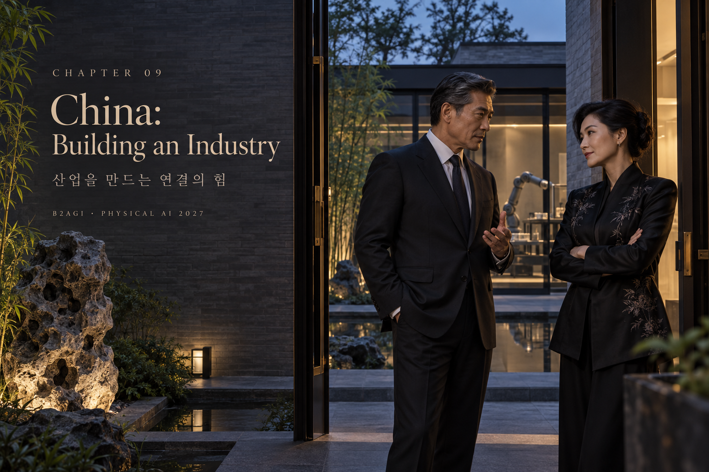
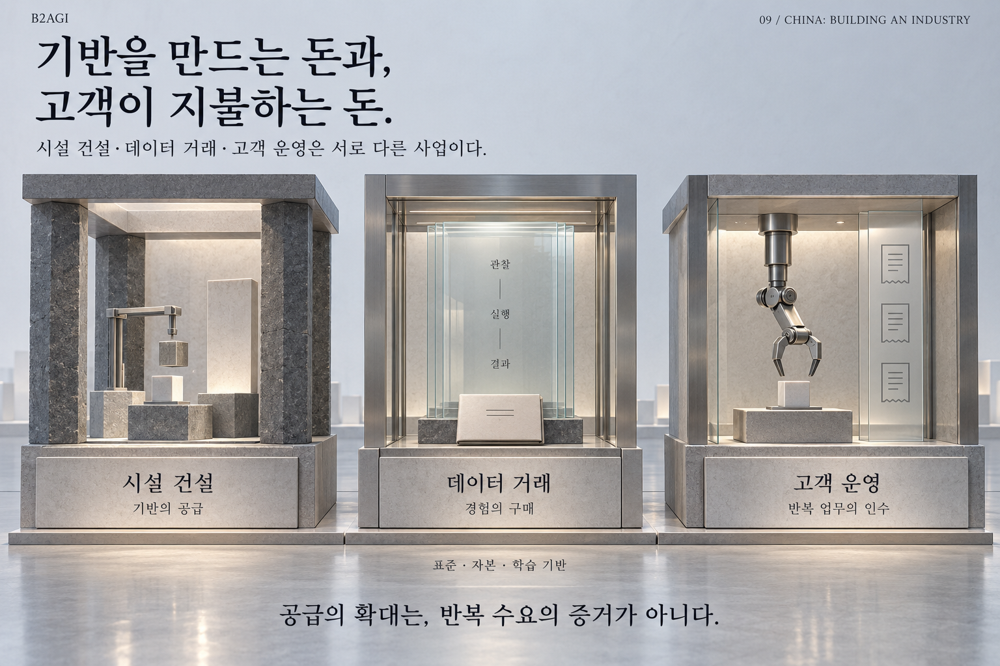

# 09 — 중국은 어떻게 산업의 기반을 만드는가

B2AGI 피지컬 AI 백서 2027 · Physical

[English](../../../chapters/09-china-building-an-industry.md) · [한국어](09-china-building-an-industry.md) · [简体中文](../../zh-CN/chapters/09-china-building-an-industry.md) · [Español](../../es/chapters/09-china-building-an-industry.md) · [Français](../../fr/chapters/09-china-building-an-industry.md)

## 장별 해설

CAICT의 불완전 통계는 2025년 12월 말 훈련장 30곳 이상, 면적 공개 21곳 합계 10만㎡ 이상을 기록한다. 베이징 1기 3,000㎡의 열 장면과 2기 6,000㎡의 네 분야·열여섯 장면, 상하이 장장의 10여 기업·100여 로봇은 서로 다른 경험을 생산하려는 구성이다. 넓이와 로봇 수가 데이터의 재사용 가치를 대신하지 않는다.

건설·공동 운영 주체의 내부 학습과 외부 데이터 판매는 다른 성과다. 톈진 파시니의 1.2만㎡ 기업 데이터 공장도 운영 구조를 따로 읽는다. 지원 발표 총액과 실제 집행·수령·사용 조건은 별도 기록이다.

[이전 장](08-reading-the-field.md) · [목차](../README.md) · [다음 장](10-china-s-industrial-clusters.md)

[B2AGI](https://b2agi.com/) · [Atlas](https://github.com/b2agi/physical-ai-ranking-2027) · [Edition & sources](../../../EDITION.md)
