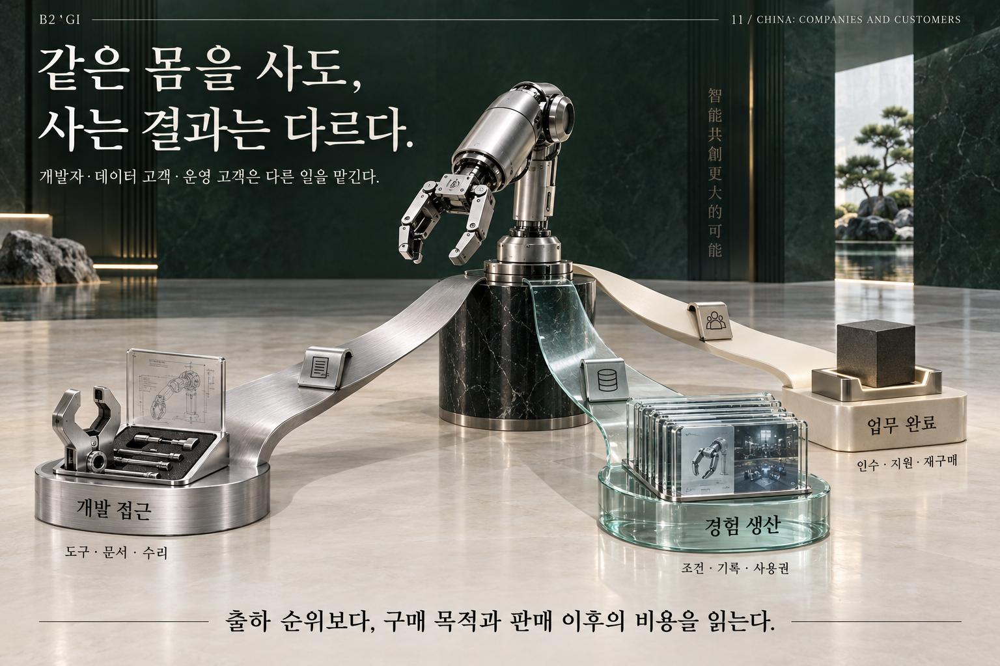

# 11 — 중국 기업: 기업의 약속, 고객의 가치

B2AGI 피지컬 AI 백서 2027 · Physical

[English](../../../chapters/11-china-companies-and-customers.md) · [한국어](11-china-companies-and-customers.md) · [简体中文](../../zh-CN/chapters/11-china-companies-and-customers.md) · [Español](../../es/chapters/11-china-companies-and-customers.md) · [Français](../../fr/chapters/11-china-companies-and-customers.md)

## 장별 해설

플랫폼과 운영 SW는 배차·충전·장애·권한을 조율한다. 공통 기능을 재사용하면 반복 매출을 만들 수 있지만 고객별 맞춤 개발과 지원이 같이 늘면 비용도 커진다. CAICT/AIIA 352개사를 세 사업군으로 재정렬한 것은 B2AGI 분석 축이지 원전의 새로운 기업 수 분류가 아니다.

[이전 장](10-china-s-industrial-clusters.md) · [목차](../README.md) · [다음 장](12-america-models-capital-and-customers.md)

[B2AGI](https://b2agi.com/) · [Atlas](https://github.com/b2agi/physical-ai-ranking-2027) · [Edition & sources](../../../EDITION.md)
