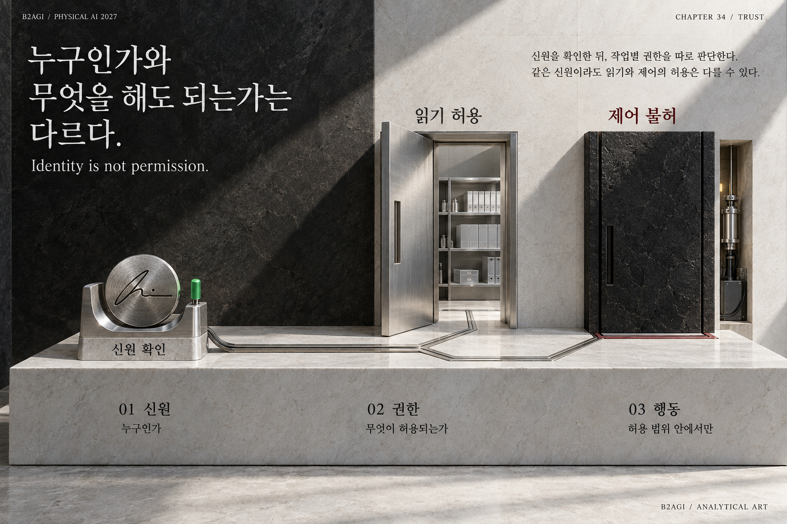

# 34 — 신원·위임·권한

B2AGI 피지컬 AI 백서 2027 · Trust

[English](../../../chapters/34-identity-delegation-and-authority.md) · [한국어](34-identity-delegation-and-authority.md) · [简体中文](../../zh-CN/chapters/34-identity-delegation-and-authority.md) · [Español](../../es/chapters/34-identity-delegation-and-authority.md) · [Français](../../fr/chapters/34-identity-delegation-and-authority.md) · [العربية](../../ar/chapters/34-identity-delegation-and-authority.md)

## 장별 해설

문을 열 수 있는 능력이 모든 문을 열 권한은 아니다. 읽기를 허용받은 같은 주체도 설비 제어는 허용받지 않을 수 있다. 이 구분은 지능을 억누르기 위한 것이 아니라, 서로 다른 조직의 공간에서 일을 맡길 수 있게 만드는 조건이다.

창고에서 화물을 옮기는 작업에는 목표를 정한 사람, 계획을 만든 모델, 명령을 전달한 서비스, 움직인 기체, 적용된 소프트웨어 판본, 결과를 인수하는 고객이 참여한다. 어느 단계에서 잘못된 지시가 생겼는지와 기체가 지시를 잘못 수행했는지는 다른 질문이다.

[이전 장](33-industrial-sovereignty-national-security-and-cooperation.md) · [목차](../README.md) · [다음 장](35-the-regulatory-landscape.md)

[B2AGI](https://b2agi.com/) · [Atlas](https://github.com/b2agi/physical-ai-ranking-2027) · [판본·자료 안내](../../../EDITION.md)
