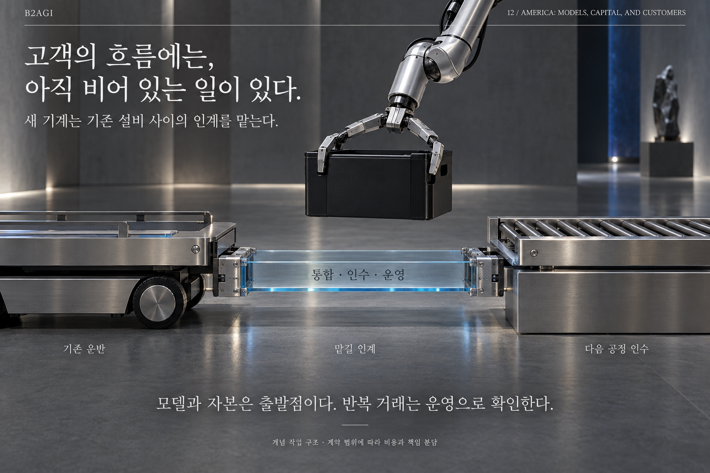

# 12 — 美国：模型、资本与客户

B2AGI 物理人工智能白皮书 2027 · Physical

[English](../../../chapters/12-america-models-capital-and-customers.md) · [한국어](../../ko/chapters/12-america-models-capital-and-customers.md) · [简体中文](12-america-models-capital-and-customers.md) · [Español](../../es/chapters/12-america-models-capital-and-customers.md) · [Français](../../fr/chapters/12-america-models-capital-and-customers.md)

## 章节导读

研究、算力和资本奠定基础。客户部署带来的集成、维护与运营要求，决定了这些基础能否支撑可重复的业务。

[上一章](11-china-companies-and-customers.md) · [目录](../README.md) · [下一章](13-america-s-industrial-clusters.md)

[B2AGI](https://b2agi.com/) · [Atlas](https://github.com/b2agi/physical-ai-ranking-2027) · [Edition & sources](../../../EDITION.md)
