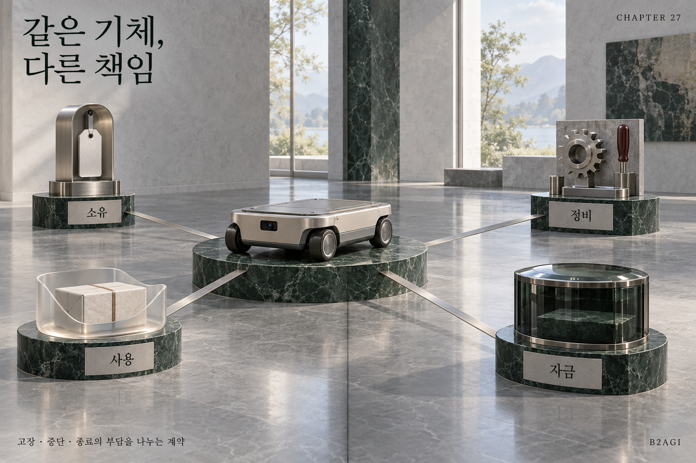

# 27 — 机器人资产融资

B2AGI 物理人工智能白皮书 2027 · Capital

[English](../../../chapters/27-financing-robot-assets.md) · [한국어](../../ko/chapters/27-financing-robot-assets.md) · [简体中文](27-financing-robot-assets.md) · [Español](../../es/chapters/27-financing-robot-assets.md) · [Français](../../fr/chapters/27-financing-robot-assets.md)

## 章节导读

融资取决于谁拥有、运营、维护设备，以及谁能将其重新部署。偿付能力来自可用现金流和围绕资产的可执行安排。

[上一章](26-reading-the-financial-statements.md) · [目录](../README.md) · [下一章](28-robot-assets-rwa-sto-and-tokenization.md)

[B2AGI](https://b2agi.com/) · [Atlas](https://github.com/b2agi/physical-ai-ranking-2027) · [Edition & sources](../../../EDITION.md)
