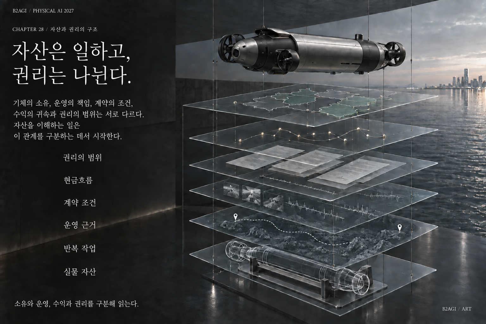

# 28 — 机器人资产、RWA、STO与代币化

B2AGI 物理人工智能白皮书 2027 · Capital

[English](../../../chapters/28-robot-assets-rwa-sto-and-tokenization.md) · [한국어](../../ko/chapters/28-robot-assets-rwa-sto-and-tokenization.md) · [简体中文](28-robot-assets-rwa-sto-and-tokenization.md) · [Español](../../es/chapters/28-robot-assets-rwa-sto-and-tokenization.md) · [Français](../../fr/chapters/28-robot-assets-rwa-sto-and-tokenization.md)

## 章节导读

实体机器、合同和数字代币代表不同对象。代币化融资需要明确权利、服务安排，以及与底层资产的可靠联系。

[上一章](27-financing-robot-assets.md) · [目录](../README.md) · [下一章](29-the-agent-transaction-economy.md)

[B2AGI](https://b2agi.com/) · [Atlas](https://github.com/b2agi/physical-ai-ranking-2027) · [版本与资料](../../../EDITION.md)
