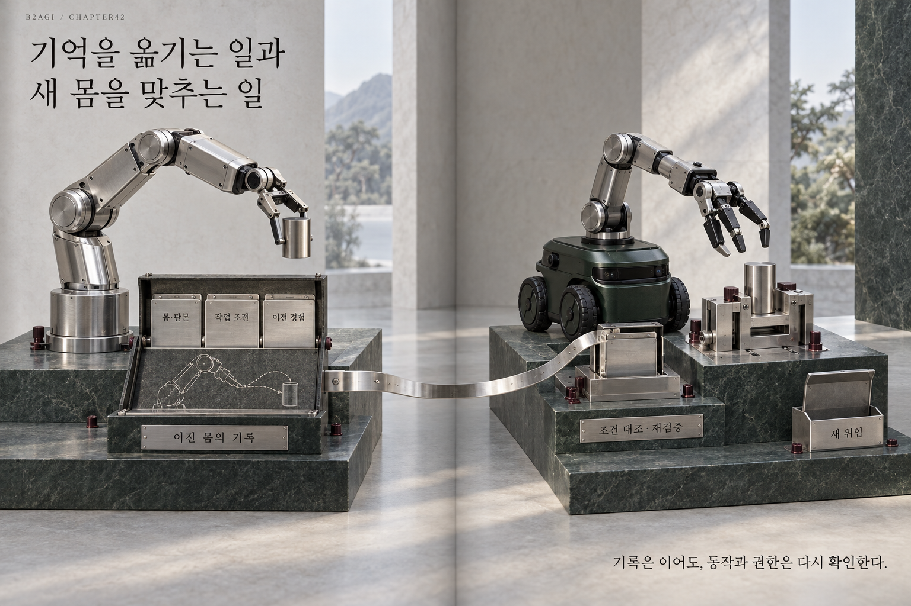

# 42 — 新的机体，延续的智能

B2AGI 物理人工智能白皮书 2027 · Beyond

[English](../../../chapters/42-new-bodies-continuing-intelligence.md) · [한국어](../../ko/chapters/42-new-bodies-continuing-intelligence.md) · [简体中文](42-new-bodies-continuing-intelligence.md) · [Español](../../es/chapters/42-new-bodies-continuing-intelligence.md) · [Français](../../fr/chapters/42-new-bodies-continuing-intelligence.md)

## 章节导读

硬件或软件改变后，既有经验仍可能有用。继续工作之前，需要确认哪些知识可迁移、哪些条件发生变化，以及哪些权限需要更新。

[上一章](41-environmental-impact-and-public-value.md) · [目录](../README.md) · [下一章](43-operating-through-disconnection.md)

[B2AGI](https://b2agi.com/) · [Atlas](https://github.com/b2agi/physical-ai-ranking-2027) · [版本与资料](../../../EDITION.md)
