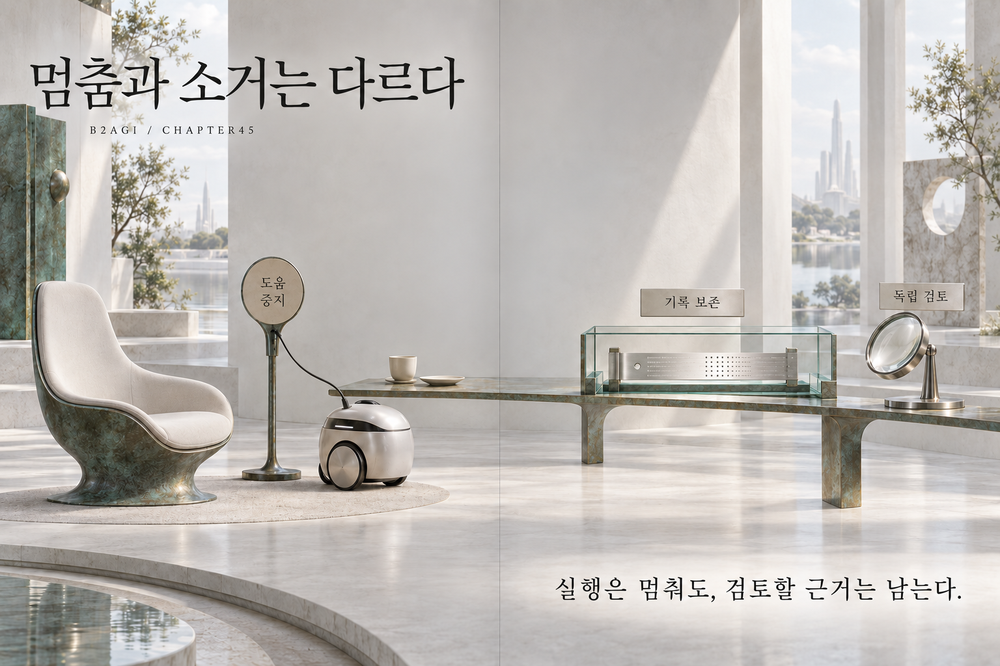

# 45 — 与非人类智能共存

B2AGI 物理人工智能白皮书 2027 · Beyond

[English](../../../chapters/45-coexistence-with-non-human-intelligences.md) · [한국어](../../ko/chapters/45-coexistence-with-non-human-intelligences.md) · [简体中文](45-coexistence-with-non-human-intelligences.md) · [Español](../../es/chapters/45-coexistence-with-non-human-intelligences.md) · [Français](../../fr/chapters/45-coexistence-with-non-human-intelligences.md)

## 章节导读

与智能机器协作，涉及委托、收益、责任与选择。共存体现在管理共享空间和共同工作的具体规则中。

[上一章](44-the-moon-and-mars-what-exploration-demands.md) · [目录](../README.md) · [下一章](46-2028-revisiting-our-judgments.md)

[B2AGI](https://b2agi.com/) · [Atlas](https://github.com/b2agi/physical-ai-ranking-2027) · [Edition & sources](../../../EDITION.md)
