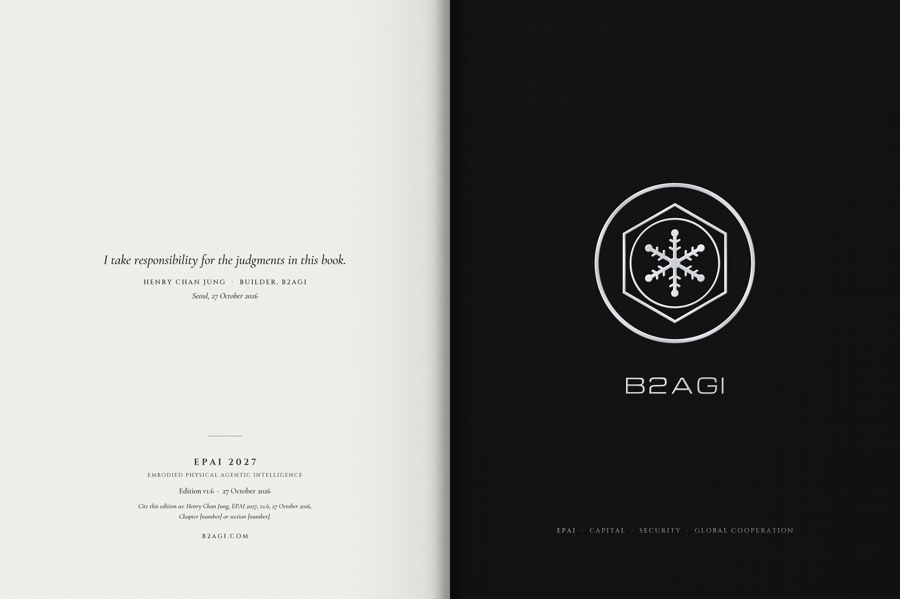

# EPAI 2027 · 99 · Closing spread

“I take responsibility for the judgments in this book.”

EPAI 2027 closes with Henry Chan Jung’s name, the edition record, and that sentence. The work can be cited. Its judgments can be revisited.

B2AGI | EPAI  
Embodied Physical Agentic Intelligence  
One ecosystem. Across borders. In your language.  
The Reference Behind the Decision.

#b2agi #epai #transoperability #AIResearch #Capital

[Instagram post](https://www.instagram.com/b2agi/p/DfAldz3E5-I/)
