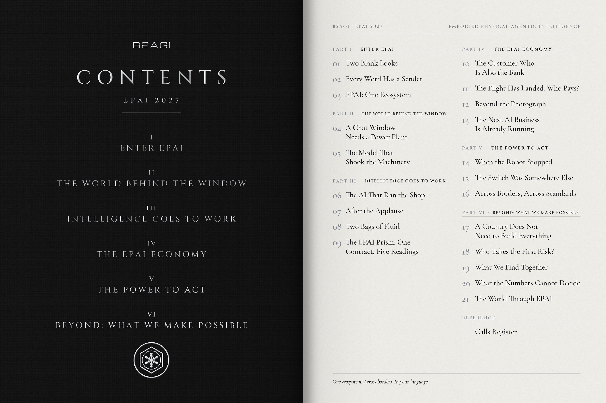

# EPAI 2027 · 03 · 목차

6부, 21장.

EPAI 2027은 지능을 부르는 서로 다른 말에서 시작합니다. 그 지능을 실제 현장에 투입하는 시스템을 따라가며, 자본과 통제권, 그리고 우리가 함께 만들 수 있는 것까지 살펴봅니다.

Calls Register에는 책의 판단을 남깁니다. 나중에 다시 꺼내 확인하기 위해서입니다.

B2AGI | EPAI  
Embodied Physical Agentic Intelligence  
One ecosystem. Across borders. In your language.  
The Reference Behind the Decision.

#b2agi #epai #transoperability #PhysicalAI #AgenticAI

[영문 게시물](https://www.instagram.com/b2agi/p/DfAl4X9k04C/)
